  

  

  

  

<table align="center">
<tr>
<td width="50%" valign="top">

**☁️ [Azure 3-Tier Migration](https://github.com/Shada11haddad/provision-terraform-via-GA)** 
A 3-tier app moved to AKS. Terraform provisions it, GitHub Actions ships it, Grafana watches it.

</td>
<td width="50%" valign="top">

**🧪 [MEYAR: LLM Evaluation](https://github.com/Shada11haddad/LLM-Eval-model)** 
GPT-4o vs DeepSeek vs Llama vs Qwen on Open QA and RAG, scored with RAGAS and an LLM judge.

</td>
</tr>
</table>

  

  
  
  

  
· · ·

  
you found the fine print!! the card above is a hand-built svg, living right here in this repo. no servers were harmed ☁️

  
make sure to give me a follow :D

